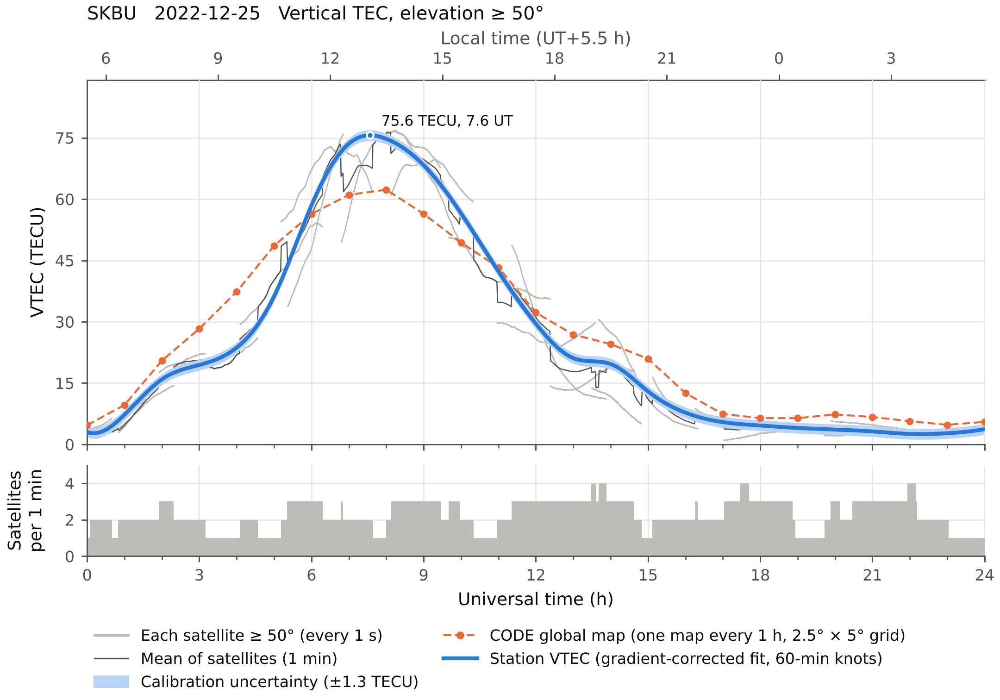
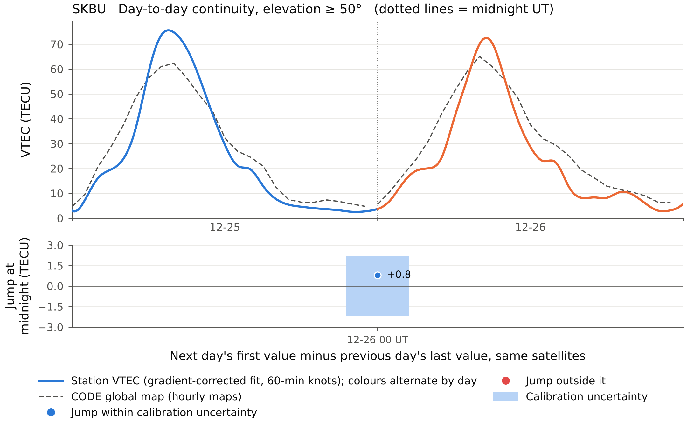
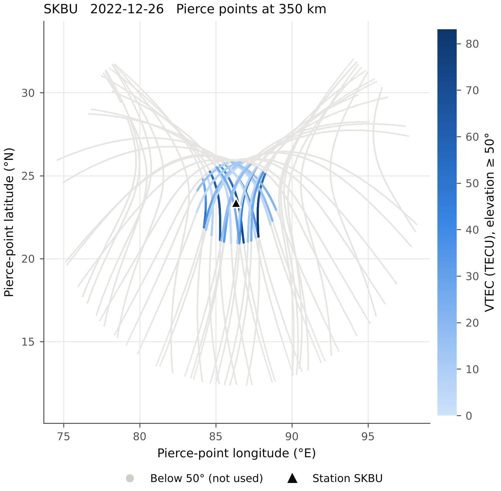

# gpstec

**Calibrated GPS total electron content (TEC) from NovAtel GPStation-6 and other dual-frequency receivers.**

[](https://github.com/dipanjanbanerjee/gpstec/actions/workflows/tests.yml)
[](https://pypi.org/project/gpstec/)

Website: https://dipanjanbanerjee.github.io/gpstec/

gpstec turns a raw GPStation-6 `.GPS` file (or any RINEX 2/3 observation file) into calibrated slant and vertical TEC, with a user-chosen elevation cut-off. It writes daily data files and publication-quality figures in one command:

```
gpstec run -c station.toml -o results  2242_0_00_skbu.GPS
```



## Why

Many GPStation-6 users go through the chain `.GPS` → RTKLIB → RINEX → a closed calibration program → `.Cmn` files. That chain has three problems:

- **Wrong station position.** RTKCONV 2.4.2 writes latitude, longitude and height into the `APPROX POSITION XYZ` header field, which expects Earth-centred coordinates. A program that trusts the header then places the station near the centre of the Earth, so every elevation, pierce point and VTEC is wrong. gpstec always takes the position from your configuration file.
- **No elevation cut-off.** Low-elevation rays need a mapping function that fails near the equatorial anomaly. gpstec lets you choose the cut-off (50° by default) and keeps all lower data out of the products.
- **No way to check the calibration.** gpstec reports independent checks for every day: the CODE global ionosphere map, a midnight continuity test, and a calibration uncertainty band.

## Install

Python 3.9 or newer:

```
pip install gpstec
gpstec install-convbin        # only needed for .GPS input: builds RTKLIB convbin (needs git, gcc, make)
gpstec init                   # writes station.toml: put your antenna position in it
```

On Ubuntu/Debian, `sudo apt install git build-essential` provides the build tools for `install-convbin`. On Windows, use the `convbin.exe` that comes with RTKLIB and set its path in `station.toml`.

## Use

```
gpstec run -c station.toml -o results  /data/2242_*.GPS        # a week of receiver files
gpstec run -c station.toml -o results  skbu3590.22o            # RINEX (.22n next to it)
gpstec run -c station.toml -o results  skbu3590.22o --elev 40  # another elevation cut-off
gpstec --version
```

Satellite bias files (CODE `.DCB`) and global ionosphere maps (CODE IONEX) are downloaded automatically into `dcb/` and `gim/`. If your network blocks the download, put the files there yourself. gpstec picks them up by date and prints the exact file names it needs.

## Method

1. **.GPS → RINEX** with RTKLIB `convbin -r nov`. The correct station position is written into the header.
2. **Geometry.** Satellite positions come from the broadcast ephemeris (or SP3 precise orbits with `--sp3`). Azimuth, elevation and pierce points are computed on a thin shell at 350 km.
3. **Slant TEC.**
   - Code: `P4 = P2 − C1`.
   - Carrier phase: `L4 = L1·λ1 − L2·λ2`.
   - Each continuous satellite pass is levelled to the code with an elevation-weighted mean above 20° (Ciraolo et al., 2007).
   - Passes that continue across midnight are levelled as one pass.
4. **Biases:** `STEC = STEC_measured + B_sat + B_rx`.
   - `B_sat` comes from CODE monthly DCBs (P1−P2, plus P1−C1 for C1 receivers) or from Bias-SINEX files.
   - `B_rx` is estimated for each day from that day's night-time data alone. It is a least-squares fit of `STEC = VTEC(t, pierce point)/M(el) − B_rx`, in which VTEC may vary north–south and east–west. That matters near the anomaly crest, where minimum-scatter methods drift.
   - Safety rule (`enforce_nonnegative`): if the estimated `B_rx` would make VTEC negative, it is raised to the smallest value that keeps 99.5 % of points ≥ 0. This shifts the whole day by one constant and is recorded in the calibration report. Individual values are never clipped. On 25–26 Dec 2022 the rule was not needed.
5. **VTEC.** `VTEC = STEC · √(1 − (Re·cos E / (Re + h))²)`, using only satellites above the elevation cut-off.
6. **Station VTEC curve.** All satellites at or above the cut-off are fitted together by weighted least squares: `VTEC_sat(t) = V0(t) + Gn(t)·Δlat + Ge(t)·Δlon`. Here V0, Gn and Ge are cubic B-splines with knots every 60 min (`smooth_knot_min`) and a curvature penalty. V0 is the VTEC above the station. The curve does not jump when a satellite rises or sets, because the north–south and east–west gradients are fitted rather than averaged into V0. No data are invented: times more than 30 min from any measurement are left empty. The plain 1-min mean of the satellites is also kept and plotted as a thin line.

## Time and space resolution

| Quantity | Interval | Where |
|---|---|---|
| Receiver observations (GPStation-6, RINEX) | **1 s** (printed in the run log) | input |
| Slant/vertical TEC of each satellite | **1 s**; every point at elevation ≥ 10° is kept, with no averaging | `.Cmn`, grey lines on the daily plots, daily STEC plot |
| Mean of the satellites | **1 min** bins of the 1 s values (elevation ≥ 50°) | `_vtec_1min.csv` column `vtec`, thin dark line |
| Station VTEC curve | fit to the 1 s data taken every 30 s, knots every **60 min**, written every 1 min | `vtec_smooth`, `.Std`, thick blue line |
| CODE global ionosphere map | **1 h** (25 maps per day, 00–24 UT), **2.5° lat × 5° lon** grid, shell 450 km | `_gim_hourly.csv` (25 rows), orange dots joined by a dashed line |
| Multi-day STEC figures | every 10 s of the 1 s data | `STAT_stec_overlay`, `STAT_stec_continuity` |

The CODE value at the station is the bilinear value from the four surrounding grid nodes (`gim_station = "bilinear"`, the IONEX convention), or the nearest node with `gim_station = "nearest"`. Only the published hourly maps are used. With a 50° cut-off at 350 km, the station's pierce points lie within about 2.5° (about 270 km) of the station.

## Checks you get for every day

- **CODE global ionosphere map** at the station: one point per hourly map on the plot. The night-time difference from the station (compared at the map epochs only) is saved, typically within 2–3 TECU.
- **Calibration uncertainty band:** the spread of independent receiver-bias estimates.
- **Midnight continuity.** Day X's file ends at 00:00:00 and the next file starts at 00:00:01, so the same satellites are seen at the same moment. gpstec compares them and splits any jump into the part caused by the receiver-bias change and the part left over from processing.



## Outputs

Per day, in `results/YYYY-MM-DD/`:

| File | Content |
|---|---|
| `STAT_DATE_vtec_1min.csv` | UT (start of each 1-min bin), 1-min mean of satellites, std, satellite count, station VTEC curve, N/E gradients, uncertainty, GIM VTEC (filled only at hh:00) |
| `STAT_DATE_gim_hourly.csv` | CODE map VTEC at the station, one row per hourly map |
| `STAT_DATE.Std` | Gopi-style `.Std` (UT, station VTEC curve, std, latitude) |
| `STAT_DATE.Cmn` | Gopi-style `.Cmn` with correct geometry (all elevations ≥ 10°) |
| `STAT_DATE_vtec.pdf/.png` | daily figure |
| `STAT_DATE_stec.pdf/.png` | slant TEC of every satellite (1 s) with its elevation |
| `STAT_DATE_pierce_points.pdf/.png` | pierce-point map coloured by VTEC |
| `STAT_DATE_calibration.json` | every bias, method, check and warning |

For multi-day runs, `results/` also gets:
- all days in one CSV;
- VTEC: an overlay figure, a day × UT map and the midnight continuity figure;
- STEC: an overlay of all days and a continuity figure with the slant-TEC jump at each midnight;
- `calibration_summary.csv` and `midnight_continuity.csv`.

## Figures

The figures are made for papers:
- vector PDF with embedded, editable fonts, plus 300 dpi PNG;
- legends outside the data area;
- a colour-blind-safe palette.

The test suite checks automatically that no two pieces of text touch. In `station.toml` you can change:
- the formats (`png`, `pdf`, `svg`, `eps`, `tiff`);
- the width (`figure_width_in = 3.5` for one journal column);
- whether titles are drawn (`figure_titles = false` when the caption goes in the paper).



## Citing

If you use gpstec in published work, please cite it (see [CITATION.cff](CITATION.cff); GitHub shows a "Cite this repository" button):

> Banerjee, D. (2026). gpstec: calibrated GPS total electron content from GPStation-6 receivers (version 1.1.0). https://github.com/dipanjanbanerjee/gpstec

## References

- Ciraolo, L., Azpilicueta, F., Brunini, C., Meza, A., & Radicella, S. M. (2007). Calibration errors on experimental slant total electron content (TEC) determined with GPS. *Journal of Geodesy*, 81, 111–120.
- Ma, G., & Maruyama, T. (2003). Derivation of TEC and estimation of instrumental biases from GEONET in Japan. *Annales Geophysicae*, 21, 2083–2093.
- Schaer, S. (1999). *Mapping and predicting the Earth's ionosphere using the Global Positioning System*. PhD thesis, University of Bern.
- Seemala, G. K., & Valladares, C. E. (2011). Statistics of total electron content depletions observed over the South American continent for the year 2008. *Radio Science*, 46, RS5019.

## Author and license

Copyright © 2026 Dipanjan Banerjee. Released under the license in [LICENSE](LICENSE).

Bug reports and questions: [GitHub issues](https://github.com/dipanjanbanerjee/gpstec/issues).
